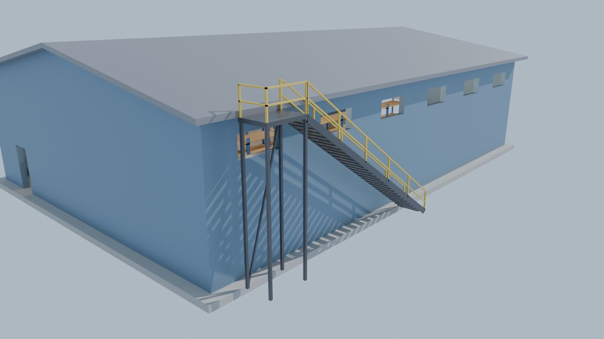

# Warehouse model

A walk-in warehouse for a Gorilla Tag–style VR fan game. It has a roll-up garage door,
rows of shelves, hanging lights, a ladder to the roof, and stairs with railings up to a
platform at the roof edge.

| File | Use it for |
| --- | --- |
| `warehouse.blend` | Open straight in Blender (5.x). Includes the lights. |
| `warehouse.fbx` | **Unity**: drag it into your Assets folder. Includes the lights. |
| `warehouse.glb` | Blender (File → Import → glTF 2.0), Bevy/Rust, Godot, or Unity with glTFast. Includes the lights. |
| `warehouse.obj` + `warehouse.mtl` | Any 3D program. Keep the two files together. **No lights** (OBJ files can't hold them). |
| `make_warehouse.py` | Regenerates the `.glb`, `.obj` and `.mtl`. Change the numbers at the top, then run `python3 make_warehouse.py`. |

Size: 18 m wide × 26 m long, 6 m walls, 7.6 m to the roof peak. Units are meters.

## What's in it (every piece is its own named object)

"Left" and "right" mean as seen standing outside, facing that wall. `LeftWall` is on
your left when you face the garage door.

- **Building:** `Floor`, `Roof_Left`, `Roof_Right`.
- **Front wall:** `FrontWall_LeftOfDoor`, `FrontWall_RightOfDoor`, `FrontWall_AboveDoor`, `FrontWall_Gable`.
- **Back wall** (it has the small door): the same four pieces, named `BackWall_…`.
- **Side walls:** `LeftWall_BelowWindows`, `LeftWall_AboveWindows`, and `LeftWall_WindowPost_1` … `_7`. `RightWall_…` is the same.
- **Garage door:**
  - `GarageDoor` is rolled up to 2.4 m, so you can walk under it. Move it down 2.4 m to close it.
  - `GarageDoor_Track_Left`, `GarageDoor_Track_Right`, `GarageDoor_RollBox`.
  - `DoorFrame_Left`, `DoorFrame_Right`, `DoorFrame_Top` (the yellow trim).
- **Roof access:**
  - `RoofLadder` is on the outside of the right wall.
  - `Stairs`, `Stairs_Railing`, `RoofPlatform` and `RoofPlatform_Railing` are on the outside of the left wall. The platform's side next to the roof is open, so you can step onto the roof.
- **Shelves:** `Shelf_LeftWall_1` … `_8`, `Shelf_MiddleLeft_…`, `Shelf_MiddleRight_…`, `Shelf_RightWall_…` (32 units, 4 shelf levels each).
- **Lights:** `Light_1` … `Light_9`. Each is a hanging lamp with a glowing bulb. In the `.fbx`, `.glb` and `.blend` files, each lamp also has a real point light named `Light_N_Lamp`.

Materials: `Concrete`, `MetalWall`, `Roof`, `Trim`, `GarageDoor`, `Steel`, `ShelfFrame`,
`Wood`, `LampBulb` (glows). They're plain colors, so you can swap in your own textures.
The UVs are set up so a texture repeats every 2 m.

## Using it in Unity

- **Colliders:** select every object and add a **Mesh Collider**. Mark them all **Static**.
  Put them on the layer your gorilla player's hands and body collide with. That makes
  the floor, walls, shelves, ladder rungs, stairs and roof all climbable.
- **Lights:** the 9 point lights come in with the `.fbx`. You'll probably need to adjust
  their **Intensity**. If you build for Quest, set them to **Baked** and bake the lighting
  (Window → Rendering → Lighting), because 9 realtime lights are heavy on a headset.
  The bulbs glow on their own either way.
