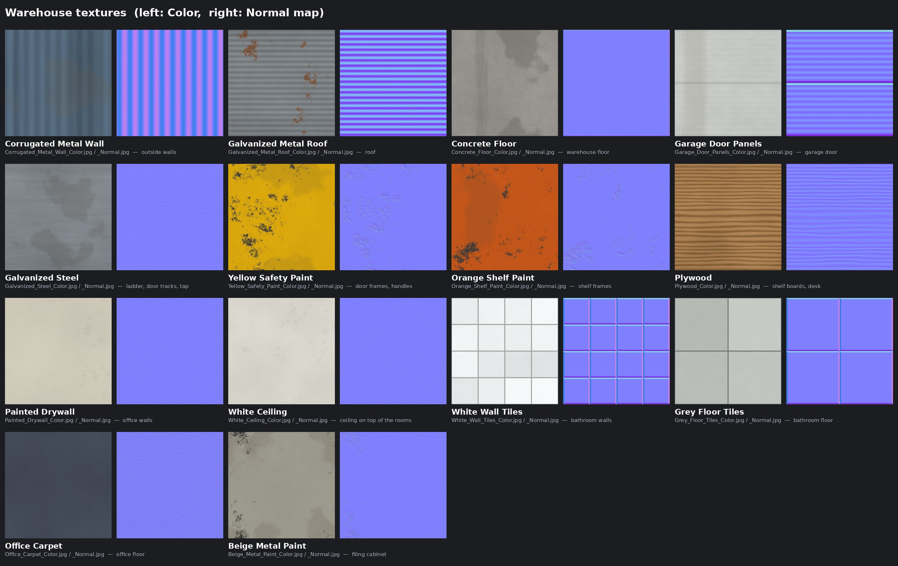

# Warehouse model

A realistic-looking walk-in warehouse for a Gorilla Tag–style VR fan game. It has a roll-up garage door,
a huge open doorway in the side wall, an office and a bathroom, a few rows of shelves, and
a ladder up to the roof.

| File | Use it for |
| --- | --- |
| `warehouse.blend` | Open straight in Blender (5.x). |
| `warehouse.fbx` | **Unity**: drag it into your Assets folder. |
| `warehouse.glb` | Blender (File → Import → glTF 2.0), Bevy/Rust, Godot, or Unity with glTFast. |
| `warehouse.obj` + `warehouse.mtl` + `textures/` | Any 3D program. Keep them together. |
| `make_textures.py` | Regenerates the textures in `textures/` (names come from `texture_names.py`). |
| `make_warehouse.py` | Regenerates the `.glb`, `.obj` and `.mtl`. Change the numbers at the top, then run `python3 make_warehouse.py`. |

Size: 18 m wide × 26 m long, 6 m walls, 7.6 m to the roof peak. Units are meters.

## What's in it

Every piece is its own object, named after its shape the way Blender names things:
`Cube`, `Cube.001`, `Cube.002` and so on, plus `Triangle` and `Triangle.001` for the
two triangular wall ends under the roof peak. Pieces built from several boxes (like a
shelf, the ladder or the desk) are one object each, like cubes joined in Blender. In the
`.blend`, `.fbx` and `.glb` files they all sit under one parent object called `Empty`.

The building:
- **Size:** 18 m × 26 m, with 6 m walls.
- **Garage door:** in the front wall, rolled up so you can walk under it.
- **Huge side opening:** 9 m × 4.3 m, in the left wall.
- **Small door:** in the back wall.
- **Ladder:** up to the roof, on the outside of the right wall.
- **Shelves:** 9 units.
- **Office and bathroom:** in the back-left corner.

"Left" and "right" mean as seen standing outside, facing that wall. The left wall is on
your left when you face the garage door.

Which object is which

| Object | What it is |
| --- | --- |
| `Cube` | Warehouse floor |
| `Cube.001` | Front wall, left of the garage door |
| `Cube.002` | Front wall, right of the garage door |
| `Cube.003` | Front wall, above the garage door |
| `Cube.004` | Back wall, right of the small door |
| `Cube.005` | Back wall, left of the small door |
| `Cube.006` | Back wall, above the small door |
| `Cube.007` | Left wall, left of the huge side opening |
| `Cube.008` | Left wall, right of the huge side opening |
| `Cube.009` | Right wall, below the windows |
| `Cube.010` | Left wall, strip above the windows |
| `Cube.011` | Left wall, post between windows #1 |
| `Cube.012` | Left wall, post between windows #2 |
| `Cube.013` | Left wall, post between windows #3 |
| `Cube.014` | Left wall, post between windows #4 |
| `Cube.015` | Left wall, post between windows #5 |
| `Cube.016` | Left wall, post between windows #6 |
| `Cube.017` | Left wall, post between windows #7 |
| `Cube.018` | Right wall, strip above the windows |
| `Cube.019` | Right wall, post between windows #1 |
| `Cube.020` | Right wall, post between windows #2 |
| `Cube.021` | Right wall, post between windows #3 |
| `Cube.022` | Right wall, post between windows #4 |
| `Cube.023` | Right wall, post between windows #5 |
| `Cube.024` | Right wall, post between windows #6 |
| `Cube.025` | Right wall, post between windows #7 |
| `Triangle` | Front wall, triangle under the roof peak |
| `Triangle.001` | Back wall, triangle under the roof peak |
| `Cube.026` | Roof, left half |
| `Cube.027` | Roof, right half |
| `Cube.028` | Yellow garage door frame, left side |
| `Cube.029` | Yellow garage door frame, right side |
| `Cube.030` | Yellow garage door frame, top |
| `Cube.031` | Yellow side opening frame, left side |
| `Cube.032` | Yellow side opening frame, right side |
| `Cube.033` | Yellow side opening frame, top |
| `Cube.034` | **Garage door** (rolled up 2.4 m; move it down 2.4 m to close it) |
| `Cube.035` | Garage door track, left |
| `Cube.036` | Garage door track, right |
| `Cube.037` | Garage door roll box (above the door, inside) |
| `Cube.038` | **Ladder** to the roof (outside the right wall) |
| `Cube.039` | **Shelf** #1 in the row along the right wall |
| `Cube.040` | **Shelf** #2 in the row along the right wall |
| `Cube.041` | **Shelf** #3 in the row along the right wall |
| `Cube.042` | **Shelf** #4 in the row along the right wall |
| `Cube.043` | **Shelf** #5 in the row along the right wall |
| `Cube.044` | **Shelf** #1 in the middle row |
| `Cube.045` | **Shelf** #2 in the middle row |
| `Cube.046` | **Shelf** #3 in the middle row |
| `Cube.047` | **Shelf** #4 in the middle row |
| `Cube.048` | Office front wall, section 1 |
| `Cube.049` | Office front wall, above the window |
| `Cube.050` | Office front wall, below the window |
| `Cube.051` | Office front wall, section 2 |
| `Cube.052` | Office front wall, above the doorway |
| `Cube.053` | Office front wall, section 3 |
| `Cube.054` | Bathroom front wall, section 1 |
| `Cube.055` | Bathroom front wall, above the doorway |
| `Cube.056` | Bathroom front wall, section 2 |
| `Cube.057` | Wall between the office and the bathroom |
| `Cube.058` | Bathroom side wall (facing the warehouse) |
| `Cube.059` | Ceiling on top of the office and bathroom (climbable) |
| `Cube.060` | Office carpet |
| `Cube.061` | Bathroom floor tiles |
| `Cube.062` | **Desk** |
| `Cube.063` | **Computer** |
| `Cube.064` | **Chair** |
| `Cube.065` | **Filing cabinet** |
| `Cube.066` | **Toilet** |
| `Cube.067` | **Sink** |
| `Cube.068` | **Mirror** |

## Materials and textures

Most materials use a realistic texture plus a normal map, which makes flat surfaces show
bumps and ridges in the light. The textures tile seamlessly and live in `textures/`.
They're already packed inside `warehouse.blend`, `warehouse.fbx` and `warehouse.glb`, so
you only need the `textures/` folder for the `.obj`.

Each texture file says what it is: `textures/<Name>_Color.jpg` is the picture, and
`textures/<Name>_Normal.jpg` is its normal map.

| Texture files | Material | Used on |
| --- | --- | --- |
| `Corrugated_Metal_Wall` | `MetalWall` | outside walls |
| `Galvanized_Metal_Roof` | `Roof` | roof |
| `Concrete_Floor` | `Concrete` | warehouse floor (cut line every 4 m) |
| `Garage_Door_Panels` | `GarageDoor` | garage door |
| `Galvanized_Steel` | `Steel` | ladder, garage door tracks and roll box, sink tap |
| `Yellow_Safety_Paint` | `Trim` | door frames, cabinet handles |
| `Orange_Shelf_Paint` | `ShelfFrame` | shelf frames |
| `Plywood` | `Wood` | shelf boards, desk |
| `Painted_Drywall` | `OfficeWall` | office walls |
| `White_Ceiling` | `RoomWall` | ceiling on top of the office and bathroom |
| `White_Wall_Tiles` | `BathroomWall` | bathroom walls |
| `Grey_Floor_Tiles` | `Tile` | bathroom floor |
| `Office_Carpet` | `Carpet` | office floor |
| `Beige_Metal_Paint` | `Cabinet` | filing cabinet |

`Porcelain` (toilet, sink), `Plastic` (chair, computer) and `Mirror` are plain colors with
no texture. The file names are set in `texture_names.py`.

To change how a texture looks, edit `make_textures.py` and run it (it needs
`pip install numpy pillow`). Then run `python3 make_warehouse.py`.

## Using it in Unity

- **Colliders:** select every object and add a **Mesh Collider**. Mark them all **Static**.
  Put them on the layer your gorilla player's hands and body collide with. That makes
  the floor, walls, shelves, rooms, ladder rungs and roof all climbable.
- **Lighting:** the model has no lights of its own. Light enters through the windows and
  doors, so add your own lights to brighten the inside. If you build for Quest, set
  them to **Baked** and bake the lighting (Window → Rendering → Lighting).
- **Textures:** select `warehouse.fbx` in the Project window and open the **Materials** tab
  in the Inspector. Click **Extract Textures…**, then **Extract Materials…**, into a folder
  of your choice. That makes every texture and material editable. If Unity asks to mark the
  `_Normal` textures as normal maps, click **Fix Now**.
- **If everything is pink:** your project uses URP or HDRP. Run the render pipeline's
  material converter on the extracted materials (for URP: Window → Rendering → Render
  Pipeline Converter). After converting, check that each material still has its texture
  and normal map.
- **For Quest:** the textures are 512–2048 px JPGs, about 2 MB in total, which is fine for
  a headset.
