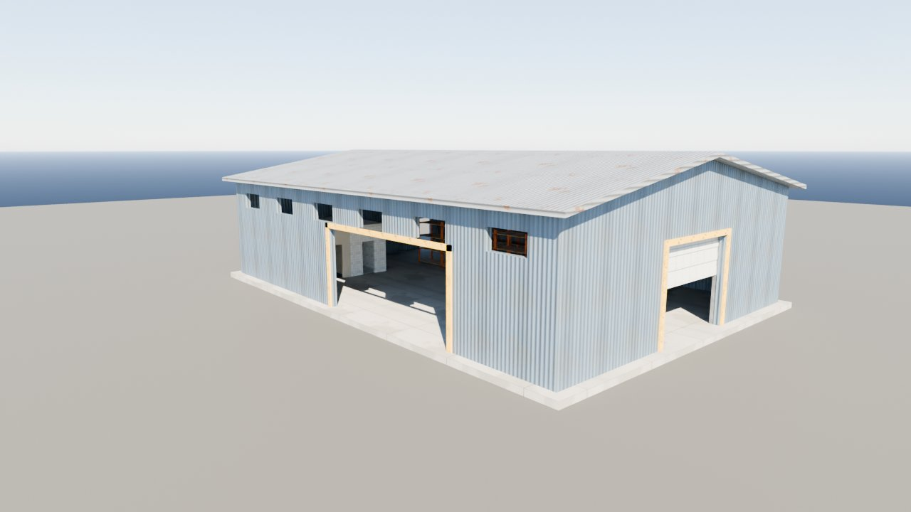
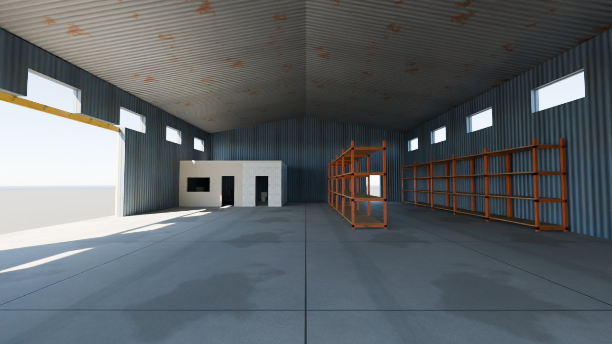
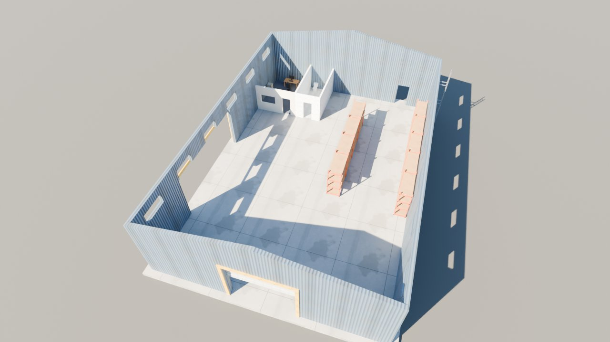
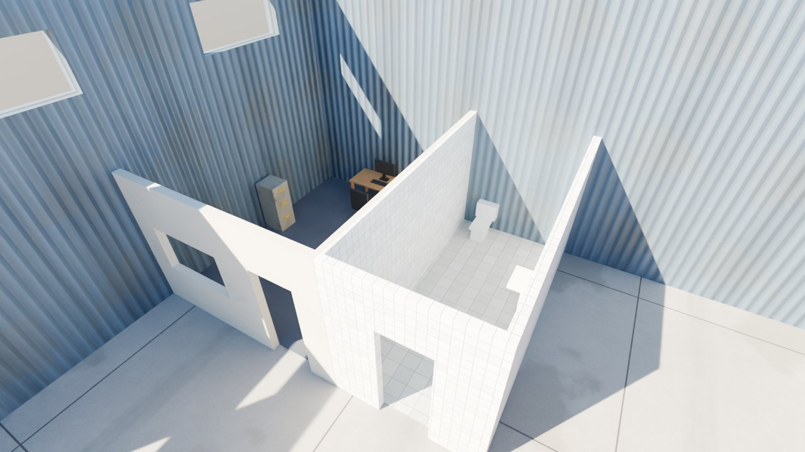
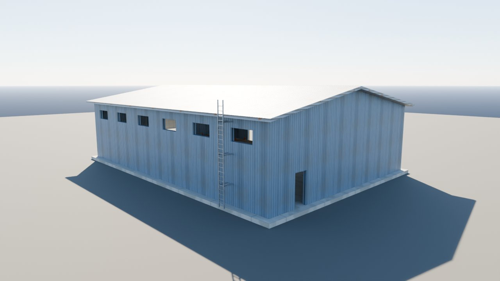

# Warehouse model

A realistic-looking walk-in warehouse for a Gorilla Tag–style VR fan game. It has a roll-up garage door,
a huge open doorway in the side wall, an office and a bathroom, a few rows of shelves, and
a ladder up to the roof.

| File | Use it for |
| --- | --- |
| `warehouse.blend` | Open straight in Blender (5.x). |
| `warehouse.fbx` | **Unity**: drag it into your Assets folder. |
| `warehouse.glb` | Blender (File → Import → glTF 2.0), Bevy/Rust, Godot, or Unity with glTFast. |
| `warehouse.obj` + `warehouse.mtl` + `textures/` | Any 3D program. Keep them together. |
| `make_textures.py` | Regenerates the textures in `textures/`. |
| `make_warehouse.py` | Regenerates the `.glb`, `.obj` and `.mtl`. Change the numbers at the top, then run `python3 make_warehouse.py`. |

Size: 18 m wide × 26 m long, 6 m walls, 7.6 m to the roof peak. Units are meters.

## What's in it (every piece is its own named object)

"Left" and "right" mean as seen standing outside, facing that wall. `LeftWall` is on
your left when you face the garage door.

- **Building:** `Floor`, `Roof_Left`, `Roof_Right`.
- **Front wall:** `FrontWall_LeftOfDoor`, `FrontWall_RightOfDoor`, `FrontWall_AboveDoor`, `FrontWall_Gable`.
- **Back wall** (it has the small door): the same four pieces, named `BackWall_…`.
- **Side walls:**
  - Left wall: `LeftWall_LeftOfOpening` and `LeftWall_RightOfOpening` (with the huge open doorway between them), `LeftWall_AboveWindows`, and `LeftWall_WindowPost_1` … `_7`.
  - Right wall: `RightWall_BelowWindows`, `RightWall_AboveWindows`, and `RightWall_WindowPost_1` … `_7`.
- **Side opening:** a 9 m × 4.3 m open doorway in the left wall, framed by `SideOpeningFrame_Left`, `SideOpeningFrame_Right` and `SideOpeningFrame_Top`.
- **Garage door:**
  - `GarageDoor` is rolled up to 2.4 m, so you can walk under it. Move it down 2.4 m to close it.
  - `GarageDoor_Track_Left`, `GarageDoor_Track_Right`, `GarageDoor_RollBox`.
  - `DoorFrame_Left`, `DoorFrame_Right`, `DoorFrame_Top` (the yellow trim).
- **Roof access:** `RoofLadder`, on the outside of the right wall.
- **Shelves:** `Shelf_RightWall_1` … `_5` and `Shelf_Middle_1` … `_4` (9 units, 4 shelf levels each).
- **Office and bathroom** (back-left corner, 3 m walls, with a flat ceiling you can climb onto):
  - Walls: `Office_FrontWall_…` (a doorway and a window), `Bathroom_FrontWall_…` (a doorway), `Office_Bathroom_Wall`, `Bathroom_SideWall`, `Rooms_Ceiling`.
  - Floors: `Office_Floor` (carpet), `Bathroom_Floor` (tile).
  - Office: `Office_Desk`, `Office_Computer`, `Office_Chair`, `Office_FilingCabinet`.
  - Bathroom: `Bathroom_Toilet`, `Bathroom_Sink`, `Bathroom_Mirror`.

## Materials and textures

Most materials use a realistic texture plus a normal map, which makes flat surfaces show
bumps and ridges in the light. The textures tile seamlessly and live in `textures/`.
They're already packed inside `warehouse.blend`, `warehouse.fbx` and `warehouse.glb`, so
you only need the `textures/` folder for the `.obj`.

| Material | Looks like | Used on |
| --- | --- | --- |
| `MetalWall` | blue-grey corrugated steel with rain streaks | outside walls |
| `Roof` | galvanized corrugated roofing with a few rust spots | roof |
| `Concrete` | sealed concrete with stains, scuffs and a cut line every 4 m | warehouse floor |
| `GarageDoor` | white steel sectional door | garage door |
| `Steel` | galvanized / brushed steel | ladder, garage door tracks and roll box, sink tap |
| `Trim` | worn safety-yellow paint | door frames, cabinet handles |
| `ShelfFrame` | chipped orange pallet-rack paint | shelf frames |
| `Wood` | plywood with grain | shelf boards, desk |
| `OfficeWall`, `RoomWall` | painted drywall | office walls, ceiling of the rooms |
| `BathroomWall` | white 15 cm wall tiles | bathroom walls |
| `Tile` | grey 30 cm floor tiles | bathroom floor |
| `Carpet` | dark office carpet | office floor |
| `Cabinet` | old beige-grey painted metal | filing cabinet |
| `Porcelain`, `Plastic`, `Mirror` | plain colors | toilet and sink, chair and computer, mirror |

To change how a texture looks, edit `make_textures.py` and run it (it needs
`pip install numpy pillow`). Then run `python3 make_warehouse.py`.

## Using it in Unity

- **Colliders:** select every object and add a **Mesh Collider**. Mark them all **Static**.
  Put them on the layer your gorilla player's hands and body collide with. That makes
  the floor, walls, shelves, rooms, ladder rungs and roof all climbable.
- **Lighting:** the model has no lights of its own. Light enters through the windows and
  doors, so add your own lights to brighten the inside. If you build for Quest, set
  them to **Baked** and bake the lighting (Window → Rendering → Lighting).
- **Textures:** select `warehouse.fbx` in the Project window and open the **Materials** tab
  in the Inspector. Click **Extract Textures…**, then **Extract Materials…**, into a folder
  of your choice. That makes every texture and material editable. If Unity asks to mark the
  `_normal` textures as normal maps, click **Fix Now**.
- **If everything is pink:** your project uses URP or HDRP. Run the render pipeline's
  material converter on the extracted materials (for URP: Window → Rendering → Render
  Pipeline Converter). After converting, check that each material still has its texture
  and normal map.
- **For Quest:** the textures are 512–2048 px JPGs, about 2 MB in total, which is fine for
  a headset.
